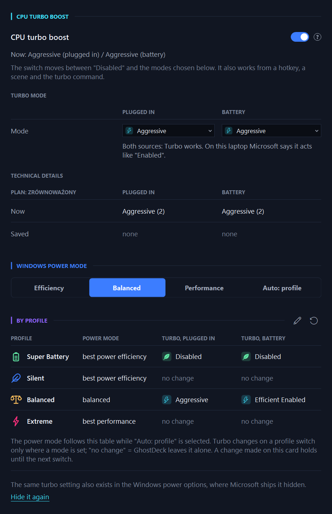
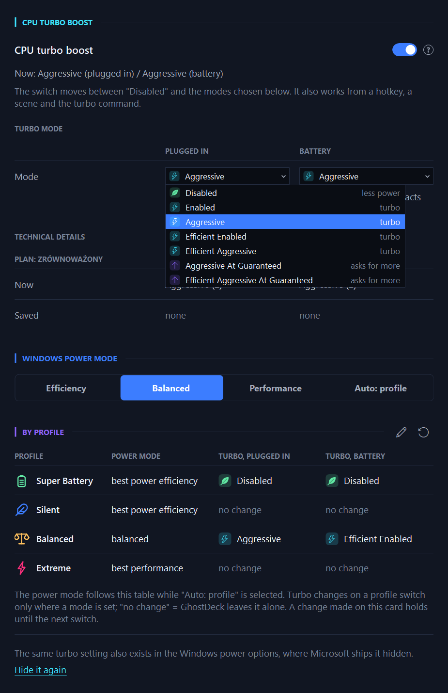
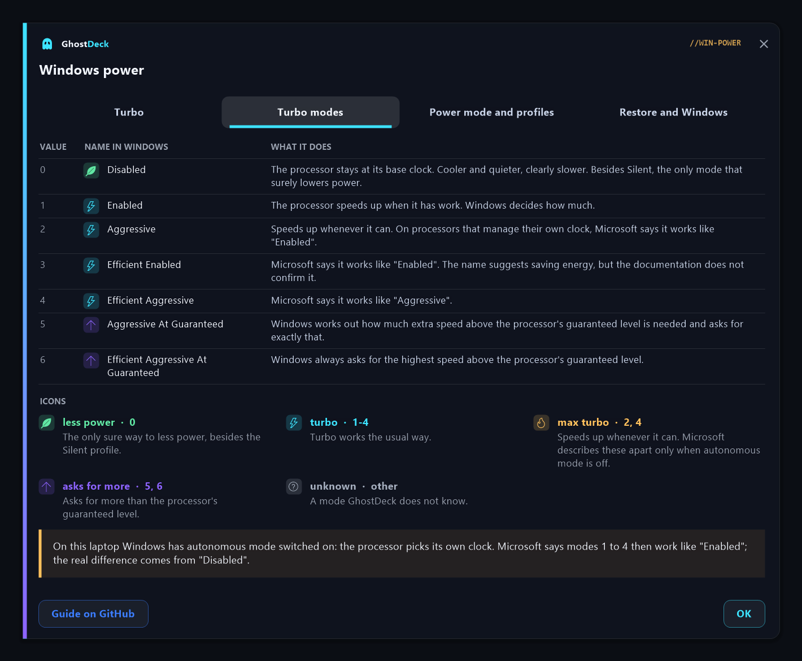
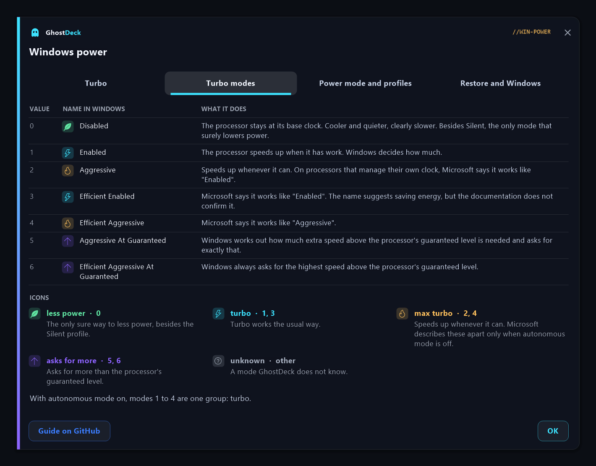
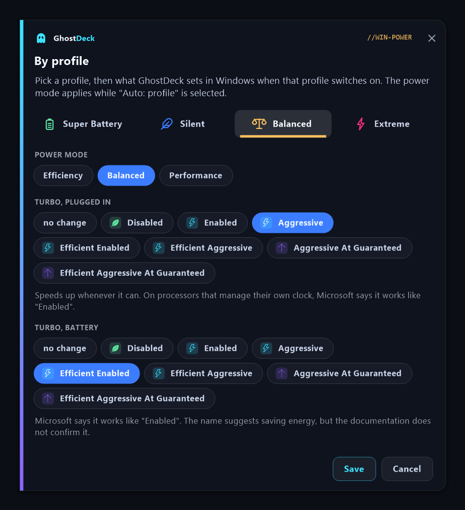
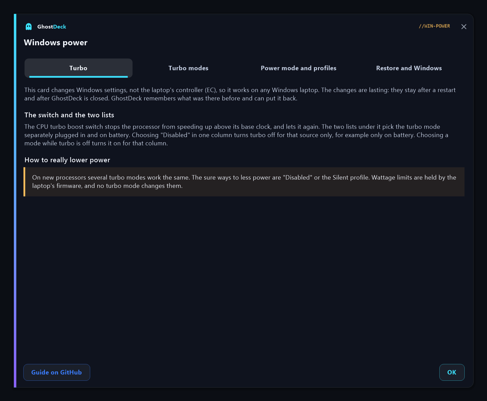

# The Windows power card

*Settings → Power → **Windows power***

Two Windows settings decide a lot about how hot, loud and fast a laptop is under load, and
Windows keeps one of them hidden: the **CPU turbo boost mode** of the power plan and the
**Windows power mode**. This card puts both next to the GhostDeck profiles they belong with.

Nothing on this card touches the laptop's embedded controller (EC). Everything goes through
documented Windows power APIs, so the card works on **any** Windows laptop, including the ones
GhostDeck cannot otherwise control.



## What is on the card

| Part | What it does |
|---|---|
| **CPU turbo boost** switch | Turns the processor's turbo boost off or back on in the active power plan. |
| **Turbo mode** (two lists) | Picks the exact turbo mode Windows uses, separately **plugged in** and **on battery**. |
| **Technical details** | The active plan's turbo mode for each source, as its Windows name with the number Windows stores ("Aggressive (2)"), and the modes the switch brings back. |
| **Windows power mode** | Best power efficiency / balanced / best performance, or **Auto: profile**. |
| **By profile** | What GhostDeck sets in Windows when a profile switches on: the power mode, and the turbo mode for each power source. |
| **Restore Windows settings** | Appears only while GhostDeck has changed something; puts it all back. |
| Footer link | Shows or hides the turbo setting in the Windows power options. |
| **?** next to CPU turbo boost | Opens the help card: everything on this page in short, with a table of the modes your Windows offers. |

## The turbo switch

With turbo **off**, the processor stays at its base clock. The laptop runs noticeably cooler
and quieter under load, and is slower at peak. Together with the Silent profile, it is the one
setting that reliably lowers power draw.

- **Off** writes "Disabled" for both power sources. Before that, GhostDeck saves the modes the
  plan had, and shows them under *Technical details → Saved*.
- **On** writes the saved modes back. If nothing was saved (turbo was switched off outside
  GhostDeck), it uses an enabled mode Windows offers.
- The switch also works from a **hotkey**, from a **scene** (its *Turbo* field) and from the
  command line: `GhostDeck.exe --turbo on|off|status`.

The change lives in the Windows power plan, not in GhostDeck: it survives a reboot and stays
in effect when GhostDeck is closed.

## Choosing the turbo mode

The two lists under **Turbo mode** hold every mode Windows offers on your machine, read live
and named in your Windows language. The number of modes depends on the processor and the
Windows version, so your list may be shorter or longer than the one below.

Every mode carries the icon of what it really does (see [What the icons mean](#what-the-icons-mean)),
in the field and in the open list, where its group is also named on the right. Under the lists is
one short line about the selected mode; when both power sources use the same mode, one line
covers both ("Both sources: ..."). The full descriptions are in the help card. On a typical
Windows 11 laptop:



| Value | Mode (Windows name in English) | What it does |
|---|---|---|
| 0 | Disabled | The processor stays at its base clock. Cooler and quieter, clearly slower. Besides Silent, the only mode that surely lowers power. |
| 1 | Enabled | The processor speeds up when it has work. Windows decides how much. |
| 2 | Aggressive | Speeds up whenever it can. On processors that manage their own clock, Microsoft says it works like *Enabled*. |
| 3 | Efficient Enabled | Microsoft says it works like *Enabled*. The name suggests saving energy, but the documentation does not confirm it. |
| 4 | Efficient Aggressive | Microsoft says it works like *Aggressive*. |
| 5 | Aggressive At Guaranteed | Windows works out how much extra speed above the processor's guaranteed level is needed and asks for exactly that. |
| 6 | Efficient Aggressive At Guaranteed | Windows always asks for the highest speed above the processor's guaranteed level. |

Most current Intel and AMD laptop processors manage their own clock, so several of these modes
can behave the same. The descriptions repeat only what Microsoft documents: modes 0-4 in the
[PERFBOOSTMODE table](https://learn.microsoft.com/en-us/windows-hardware/customize/power-settings/options-for-perf-state-engine-perfboostmode),
modes 5 and 6 in the [ProcessorPerformanceBoostMode reference](https://learn.microsoft.com/en-us/dotnet/api/microsoft.windows.eventtracing.power.processorperformanceboostmode).
"Guaranteed" is a level the processor reports about itself, not a cap: both of those modes ask
for more than it. A mode Windows lists that GhostDeck does not know is shown as such.

**Autonomous mode.** Windows has a second hidden setting, *Processor performance autonomous mode*
(PERFAUTONOMOUS). When it is on, Windows lets the processor pick its own clock, and Microsoft's
table then gives modes 1 to 4 the same behaviour as *Enabled*: the real difference comes from
*Disabled*. GhostDeck only reads this setting. When the active plan has it on for both power
sources, the help card says so under its table of modes, and the test reports record it.
Microsoft notes that the platform may ignore the setting, so GhostDeck reports what Windows has
switched on, not what the processor does.

## What the icons mean

Seven names, but only a few different behaviours. GhostDeck sorts the modes into groups by
Microsoft's own tables and gives each group one icon and colour, everywhere a mode appears: the
lists, the *By profile* table, the editor and the help card.

| Icon | Group | Modes | What it means |
|---|---|---|---|
| green leaf | **less power** | 0 | The only sure way to less power, besides the Silent profile. |
| blue lightning bolt | **turbo** | 1, 3 (1 to 4 with autonomous mode on) | Turbo works the usual way. |
| amber flame | **max turbo** | 2, 4 (only with autonomous mode off) | Speeds up whenever it can. Microsoft describes these apart only when autonomous mode is off. |
| violet up arrow | **asks for more** | 5, 6 | Asks for more than the processor's guaranteed level. |
| grey question mark | **unknown** | any other | A mode GhostDeck does not know. |

With autonomous mode on (see above), modes 1 to 4 are one group: turbo. The help card shows the
same legend under its table of modes:





**Picking a mode while turbo is off** turns turbo on for that power source. Picking *Disabled*
in one list switches turbo off for that source only (for example: off on battery, full speed
plugged in). The switch then stays on, and the line under it says exactly which mode each
source uses.

## By profile

The **By profile** table lists, for each GhostDeck profile, what is set in Windows when that
profile switches on:

- **Power mode**: used while the Windows power mode is on **Auto: profile**. The defaults are
  Silent and Super Battery → best power efficiency, Balanced → balanced, Extreme → best
  performance.
- **Turbo, plugged in** and **Turbo, battery**: a turbo mode, or **no change**. *No change* is
  the default for every profile, so nothing happens until you set something.

The pencil opens the editor: pick a profile at the top, then the power mode and the turbo mode
for each power source. The arrow next to it restores the defaults.



Profiles apply these settings **once, at the switch**. A change you make on the card or in
Windows afterwards stands until the next profile switch; GhostDeck does not fight it.

Turbo modes are written into whatever power plan is active at that moment.

## Restore Windows settings

GhostDeck remembers what each power plan had before its **first** turbo change, and the power
mode before its first power-mode change. While anything is held, *Restore Windows settings*
appears at the bottom of the card, lists what will come back, and on confirmation:

- writes every changed plan back to its original turbo modes (without switching plans),
- puts the power mode back,
- turns *Auto: profile* off.

**I removed GhostDeck while turbo was off.** The setting stays off, because it belongs to the
Windows plan. Start GhostDeck once more and use *Restore Windows settings*, or run
`GhostDeck.exe --turbo on`, or put it back from an administrator terminal (`2` = Aggressive, the
usual Windows default):

```
powercfg -setacvalueindex scheme_current sub_processor perfboostmode 2
powercfg -setdcvalueindex scheme_current sub_processor perfboostmode 2
powercfg -setactive scheme_current
```

## Showing the setting in the Windows power options

Windows hides *Processor performance boost mode* from its own power options. The footer link
*Show it there* makes it visible under Control Panel → Power Options → Change advanced power
settings → Processor power management, and *Hide it again* puts back exactly what was there.
GhostDeck does not need this to work; it is for people who want to check or change the setting
in Windows too. Both directions ask first, because the change stays in Windows even after
GhostDeck is removed.

On laptops with **Modern Standby** (most recent ones) Windows lists the setting only when it is
also marked to be shown on such machines. GhostDeck sets that mark. This is why
`powercfg -attributes SUB_PROCESSOR be337238-0d82-4146-a960-4f3749d470c7 -ATTRIB_HIDE` alone does
not make it appear on those laptops.

## The help card

The **?** next to *CPU turbo boost* opens a GhostDeck card with four pages: the switch and the
two lists (and the sure ways to less power), a table of every turbo mode your Windows offers
(value, the Windows name with its group icon, what it does) with the icon legend under it, the
power mode and *By profile*, and *Restore* with the Power Options link. Its *Guide on GitHub*
button opens this page. The pictures of the modes page are in
[What the icons mean](#what-the-icons-mean).



## Test reports

The power test and the backup path test write the Windows power state into their report header:
the active plan, the turbo mode for each power source (number and Windows name), autonomous mode
for each power source, and the power mode. A run with turbo off measures a different machine,
and the report says so.

## More

- [FAQ: Can GhostDeck turn CPU turbo boost off?](FAQ.md#can-ghostdeck-turn-cpu-turbo-boost-off-what-is-the-windows-power-card)
- [CLI reference](CLI.md) (`--turbo`)
- [TECHNICAL.md §71](TECHNICAL.md#71-the-windows-power-card-turbo-boost-and-the-windows-power-mode-v137-discussion-141) - how the card works inside
- Microsoft: [Processor performance autonomous mode](https://learn.microsoft.com/en-us/windows-hardware/customize/power-settings/options-for-perf-state-engine-perfautonomousmode)
- Microsoft: [Processor performance boost mode](https://learn.microsoft.com/en-us/windows-hardware/customize/power-settings/options-for-perf-state-engine-perfboostmode)
